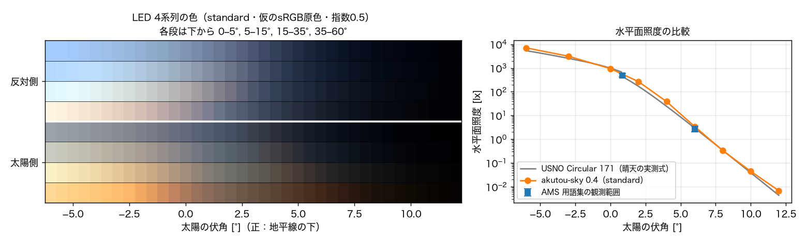

# akutou-sky

あくとう（朝焼け・夕焼け・薄明投影機）のために、**理想的な晴天の朝焼け・夕焼け・薄明の空の色と明るさ**を球面大気の放射伝達計算で求め、ESP32 の LED 駆動表まで作るライブラリです。ライブラリ 0.4.0 / モデル 3.0。

- 計算の中身と根拠：[docs/モデルと根拠.md](docs/モデルと根拠.md)
- 精度（数値収束と実測照度との比較）：[docs/精度検証.md](docs/精度検証.md)
- ChatGPT 作の旧版（0.3.0）のコード・結果・ログは [archive/v0.3/](archive/v0.3/) に移しました

## 0.3 からの主な変更

| | 旧版 0.3 | 新版 0.4 |
|---|---|---|
| 実測照度との比（伏角2〜6°） | 2.3〜3.4倍（明るすぎ） | 1.2〜1.6倍（伏角−6〜12°全体で0.96〜1.58倍） |
| 原因 | 太陽光屈折で光路だけ曲げ、屈折による減光を無視 | 屈折は既定で無効（理由は docs に記載） |
| 角度分割 | 入射・出射とも110方向（深い薄明で未収束） | 入射302方向・出射50方向（誤差を支配する入射側に集中） |
| 偏光 | スカラーのみ（輝度最大13%・色度0.015のずれ） | 粗い格子で求めた偏光の効果を加算 |
| 設定 | 53項目・6プリセット | 物理 `Scene`（19項目）と数値 `Numerics`（14項目）に分離、3プリセット |
| 出力 | 表示用 sRGB まで | RevC 4帯域の XYZ と ESP32 用 PWM 表（Cヘッダ） |
| コード（Python） | 約2,200行（検証ツール含む） | 約1,500行（LED 出力・照度検証を含む） |



## インストール

Python 3.11–3.13。このフォルダで実行します。

```sh
sh setup_environment.sh          # Mac: ~/Library/Caches/akutou-science/python313 に環境を作る
python -m pip install -e .       # 既存の Python 環境に入れる場合
```

計算に必要な大気データ（オゾン断面積・太陽スペクトル・標準大気）は `model_cache/` に入っています。`--cache-dir model_cache --offline` を付ければネットに接続しません。

## 使い方

### 1. 空を計算する

```sh
akutou-sky run --scene standard --cache-dir model_cache --offline --output results/standard
```

伏角 −6°〜＋12°（0.5°刻み）、太陽側・横・反対側の3方位、高度0〜90°の13方向を計算し、`sky.nc`（分光放射輝度）、`colors.csv`（各方向の XYZ・xy・輝度）、`bands.csv`（RevC の4高度帯の平均）を保存します。`--scene` は `clear` `standard` `hazy` `urban` `rural` `humid` `dry` または JSON ファイル、`--numerics preview` で速い確認計算になります。

### 2. LED 駆動表を作る

```sh
akutou-sky led results/standard/sky.nc
```

`led_table.csv` と ESP32 用の `akutou_sky_table.h` を作ります。ヘッダには伏角ごと・4高度帯ごとの R・G・B デューティ（0〜1、光量に比例）と、伏角で補間する `akutouDuty(depression, band, rgb)` が入っています。

```c
#include "akutou_sky_table.h"
// 夕焼け：p = 0→1 で伏角を −6° から +12° へ
float d = -6.0f + 18.0f * p, rgb[3];
akutouDuty(d, 0, rgb);        // 帯0 = 高度 0–5°
setRgb(rgb[0], rgb[1], rgb[2]);
```

既定の LED 原色は仮の sRGB 値です。LED の色度と最大輝度を測ったら [led_primaries.example.json](led_primaries.example.json) の形式で書き、`--primaries` で渡してください。明るさの圧縮は `--exponent`（既定0.5、1で実際の空に比例）、方位は `--azimuth` で変えられます。

### 3. 4種類の空を見比べる

```sh
akutou-sky explore --cache-dir model_cache --offline      # → results/explorer/index.html
```

都会・田舎・湿度が高い日・低い日の4種類について、塵4段階×霧4段階×伏角25点を計算したオフライン HTML を作ります。LED 4系列での見え方も表示します。全条件の計算には 16 GB の Mac で約10時間かかります（計算済みの条件は再利用）。

### 4. 精度を確かめる

```sh
akutou-sky check --scene standard --cache-dir model_cache --offline
```

数値設定を1項目ずつ細かくしたときの差（収束テスト）と、計算した空から求めた水平面照度と実測に基づく晴天照度（USNO Circular 171）の比較を `results/checks/` に保存します。

### Python から

```python
from akutou_sky import SCENES, render, add_color, led_table

scene = SCENES['standard'].replace(aod550=0.15)        # 物理条件は Scene
sky = add_color(render([0, 3, 6], scene, 'final',       # 数値設定は Numerics（'preview'/'final'）
                       azimuths=[0, 180], cache_dir='model_cache', allow_download=False))
sky.XYZ.sel(tristimulus='Y')                            # 輝度 cd/m²
table = led_table(sky, azimuth=0)                       # table['duty'][伏角, 帯, RGB]
```

## 構成

```text
src/akutou_sky/
  scene.py     物理条件 Scene と名前付きの大気 SCENES
  numerics.py  数値設定 Numerics（preview / final）と格子
  optics.py    Rayleigh・オゾン・エアロゾル（吸湿成長）・成層圏層・霧・太陽光
  solver.py    SASKTRAN2 による放射伝達（render）
  delta_m.py   前方散乱の Delta-M 打切りと1回散乱の補正
  color.py     XYZ・xy・輝度、RevC 4高度帯の平均
  led.py       LED デューティ表と ESP32 ヘッダ
  check.py     収束テストと実測照度との比較
  explorer.py  比較ページ（templates/explorer.html）
  io.py, cli.py
tests/         高速な単体テスト（python -m unittest discover -s tests）
docs/          モデルの説明と精度検証
model_cache/   大気データと Mie 計算のキャッシュ
archive/v0.3/  旧版一式
```

## 注意

- 比較・演出のための仮想的な晴天大気です。特定の日・場所の空の予報ではありません。
- 太陽円盤、夜光・星・月・街明かり、雲、地形は含みません。伏角12°を超える深い薄明では背景光が支配的になります。
- LED の値は、実機の原色・配光・ドーム反射を測って校正してから使ってください。
