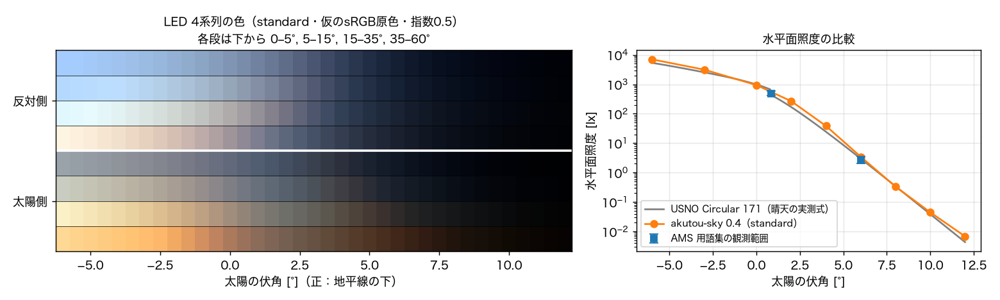

# 精度検証（akutou-sky 0.5 / モデル3.1）

精度を2つの面から確かめました。

1. **数値の収束**：数値設定を細かくしても答えが変わらないか（計算方法の誤差）
2. **実測との比較**：計算した空から求めた水平面照度が、晴天の実測に基づく照度と合うか（物理モデルの誤差）

判定には、投影機が実際に使う **RevC 4高度帯の平均 XYZ** を主に使います。基準は「輝度差3%以内・色度 xy の差0.003以内」です。結果ファイルは `results/checks/` にあり、`akutou-sky check` で再現できます。

## 1. 実測照度との比較

`standard` 大気・`final` 設定で、全天（方位0〜180°×高度0〜90°）の輝度を積分した水平面照度（太陽が地平線より上なら直達光も加算）を、米海軍天文台の晴天照度モデル（USNO Circular 171、Janiczek & DeYoung 1987。Bond & Henderson の実測への当てはめ式）と比べました。

| 伏角 | モデル [lx] | USNO [lx] | 比 | 天頂輝度 [cd/m²] | 天頂の色度 x, y |
|---:|---:|---:|---:|---:|---|
| -6° | 7045 | 5363 | 1.31 | 648 | 0.259, 0.272 |
| -3° | 3146 | 2557 | 1.23 | 398 | 0.263, 0.277 |
| +0° | 941.9 | 984.5 | 0.96 | 144 | 0.262, 0.275 |
| +2° | 267.6 | 169 | 1.58 | 41.9 | 0.257, 0.264 |
| +4° | 38.59 | 24.44 | 1.58 | 5.62 | 0.246, 0.248 |
| +6° | 3.461 | 2.992 | 1.16 | 0.477 | 0.226, 0.226 |
| +8° | 0.3363 | 0.3447 | 0.98 | 0.0377 | 0.216, 0.205 |
| +10° | 0.04492 | 0.03886 | 1.16 | 0.00565 | 0.213, 0.195 |
| +12° | 0.00684 | 0.004365 | 1.57 | 0.00096 | 0.210, 0.190 |

- 伏角−6°（太陽高度6°）から＋12°まで、**照度は実測式の0.96〜1.58倍**に収まりました。晴天の照度は大気の濁りで数十%変わるため（`hazy` 大気では standard の約2/3〜3/4）、この差は実大気のばらつきの範囲です。
- 米国気象学会の用語集は、晴れた夕方の常用薄明で水平面照度が「日没時 約410〜585 lx から、終わり（伏角6°）に約2〜3.5 lx まで下がる」としています（[AMS Glossary: civil twilight](https://glossary.ametsoc.org/wiki/civil-twilight/)）。モデルは日没（太陽上端が地平線、伏角0.83°）で約560 lx、伏角6°で3.5 lx で、範囲内です。
- 天頂は伏角とともに青くなり（x 0.26 → 0.21）、オゾンの Chappuis 吸収による薄明の天頂の青さ（Hulburt 1953）と整合します。
- 結果ファイル：`results/checks/illuminance_standard.json`

## 2. 旧版から見つかって直した問題

### 太陽光の屈折で薄明が約2倍明るくなっていた

旧版（0.3.0）は SASKTRAN2 の太陽光屈折を有効にしていました。SASKTRAN2 は太陽光の経路を曲げて地球の影を後退させますが、[公式ドキュメント](https://sasktran2.readthedocs.io/en/latest/users_guide/refraction.html)に記載のとおり、屈折による光束の広がり（屈折減光）は計算しません。その結果、伏角2〜6°の照度が実測式の2.3〜3.4倍、天頂の色が黄色寄り（x = 0.29）になっていました。

| 伏角 | 屈折あり：照度 / 実測式 | 屈折なし：照度 / 実測式 | 天頂の色度 x（あり → なし） |
|---:|---:|---:|---|
| 0° | 1.32 | 0.97 | 0.269 → 0.260 |
| 2° | 2.81 | 1.61 | 0.279 → 0.256 |
| 4° | 3.42 | 1.66 | 0.292 → 0.242 |
| 6° | 2.31 | 1.13 | 0.266 → 0.220 |

（preview 設定・standard 大気での切り分け計算。エアロゾルを除いた大気でも同じ傾向で、エアロゾルや成層圏層が原因ではありませんでした。）屈折なしにすると、伏角とともに天頂が青くなる観測どおりの振る舞いになり、照度も実測の範囲に入ります。屈折は `Numerics(solar_refraction=True)` で戻せます。

### 角度の積分点数が足りなかった

旧版は散乱光の方向を Lebedev 110点（入射・出射とも）で表していましたが、深い薄明では点数を増やすたびに結果が10〜20%変わり、収束していませんでした。入射と出射を別々に変えて調べたところ、効いているのは**入射方向の積分点数**だけで、出射（散乱源の標本）は50点で十分でした（26→110点で差2%以下）。

| 入射点数（出射50点） | 434点との差：伏角0° | 伏角6° | 伏角12° |
|---|---|---|---|
| 194 | 輝度0.1%、xy 0.0005 | 輝度11.6%、xy 0.010 | 輝度16.9%、xy 0.068 |
| **302（既定）** | 輝度0.05%、xy 0.0001 | 輝度4.7%、xy 0.005 | 輝度3.0%、xy 0.016 |
| 434 | 0 | 0 | 0 |

（帯平均・太陽側/横/反対側の最大値。590点はメモリ19 GBを超えて計算できませんでした。）一方、高度格子・散乱源格子・1回散乱格子は旧版の半分程度まで粗くしても差0.5%未満だったため、そこで浮いたメモリを入射点数に回しました。

### 偏光を無視していた

スカラー計算は Rayleigh 散乱の偏光を無視します。エアロゾルなしの大気で I/Q/U を解いた結果と比べると、伏角4°で輝度が最大13%、色度が0.015ずれました。既定では「同じ粗い格子でのベクトル計算−スカラー計算」の差を加える補正を入れ、I/Q/U を直接解いた結果との差を輝度2.6%・色度0.0034まで減らしています（下の「補足」の表）。

## 3. 数値の収束

`standard` 大気、伏角 −6, −3, 0, 3, 6, 9, 12°、方位0/90/180°、高度0〜60°の12方向で、`compare` 設定（`final` の波長幅を20 nm にしたもの）を基準に1項目ずつ細かくしました。表は RevC 4帯域平均の最大差（輝度 / 色度 xy 距離）です。

| 数値設定 | 変更 | 伏角 −6〜3° | 伏角 6〜12° |
|---|---|---|---|
| 入射方向の積分点数 | 302 → 434 | 0.1% / 0.0004 | 7.2% / 0.0151 |
| 出射方向の標本数 | 50 → 74 | 2.0% / 0.0010 | 4.3% / 0.0018 |
| 水平格子の刻み | 0.5 → 0.25 | 1.4% / 0.0004 | 2.2% / 0.0008 |
| 細かい水平格子の範囲 | 3 → 6 | 0.0% / 0.0000 | 0.4% / 0.0001 |
| 多重散乱の高度格子 | 50/500/2000/4000 → 25/250/1000/2000 | 未実行（メモリ上限） | 下の補足を参照 |
| 散乱源の高度格子 | 100/2000/4000/8000 → 50/1000/2000/4000 | 未実行（メモリ上限） | 下の補足を参照 |
| 1回散乱の高度格子 | 25/125/250/500 → 12.5/62.5/125/250 | 0.0% / 0.0000 | 0.0% / 0.0000 |
| 波長幅 | 20 → 10 | 0.2% / 0.0018 | 0.5% / 0.0023 |
| 位相関数の Legendre 係数 | 64 → 128 | 0.0% / 0.0000 | 0.0% / 0.0000 |
| Delta-M 次数 | 16 → 32 | 0.0% / 0.0000 | 0.0% / 0.0000 |
| 偏光補正 → I/Q/U 直接計算 | scalar + coarse-grid correction → full I/Q/U | 未実行（メモリ上限） | 下の補足を参照 |

- **日の入り前後（伏角3°まで）**は、全項目で輝度差2%以内・色度差0.002以内でした（基準：3%・0.003）。
- **深い薄明（伏角6〜12°）**は、入射方向の積分点数による差が輝度で最大7%、伏角12°の色度で0.015残ります（基準外）。メモリ（16 GB）の範囲では入射434点が上限で、590点は19 GB を超えて計算できませんでした。輝度はLED表で0.5乗に圧縮されるため、7%の差は表示で約3.5%に相当します。
- 波長幅は `final` の10 nm で、20 nm との差（色度0.0023）より十分小さくなります。
- 1回散乱の高度格子・Legendre 係数・Delta-M 次数・水平格子の範囲は差0.4%以下で、十分に収束しています。
- 外側の水平列の間隔を1.5倍ずつ→2倍ずつ広げる変更（メモリ節約）による差は、伏角12°で1.2%、それ以外は0.01%未満でした。
- 結果ファイル：`results/checks/convergence_standard.json`

### 霧（高湿度の水滴）を外した理由

0.4 は `humid` 大気（RH 90%・霧AOD 0.2）と比較ページの霧スライダーで、地表付近の水滴（中央値半径5 µm）を扱っていました。水滴は前方に非常に鋭く散乱するため、数値設定による差が晴天よりずっと大きく、基準（3%・0.003）を満たせませんでした。下の表は `humid` 大気で Delta-M 次数を変えたときの帯平均の最大差です（`compare` 設定。晴天では差0.01%）。

| 次数 | 伏角 −6° | −3° | 0° | 6° | 12° |
|---|---|---|---|---|---|
| 8 → 16 | 22.8% | 37.8% | 3.1% | 3.0% | 3.0% |
| 16 → 32 | 12.1% | 24.6% | 5.2% | 4.4% | 4.4% |

- 差の大部分は、太陽が地平線より上にあるとき（伏角 −6°・−3°）の、太陽から数度以内の視線（霧による光環）に集中していました。
- ほかの項目の差も晴天より大きくなりました。入射方向の積分点数は最大8.7%、出射方向の標本数は7.5%です（次数16の時点。`archive/fog/convergence_humid.json`）。
- 収束させるには Delta-M 次数64と入射約1200方向が必要です。しかし入射590方向で19 GB、次数64は伏角1つでも13 GB を超え、16 GB の Mac では計算できませんでした（入射302方向の Lebedev 求積が正確に積分できるのは29次まで）。

メモリの制約で精度を確保できないため、0.5 では霧を外しました。`humid` 大気、比較ページの「湿度が高い」ページと霧スライダーを削除しています。

### 湿度の上限を RH 70% にした理由

湿度による微粒子の吸湿成長は残しましたが、上限を RH 95% から 70% に下げました。水を吸った微粒子は水滴ほど前方散乱が鋭くありません（Delta-M 次数16→32の差は1.1%以内）。しかし、粒が大きく量が多い大気では、散乱光を標本にする**出射方向の数**（50→74）による差が大きくなりました（`compare` 設定、帯平均の最大差、輝度 / 色度）。

| 大気（湿ったときの AOD） | 伏角 −6〜3° | 6° | 結果ファイル（`results/checks/`） |
|---|---|---|---|
| standard（0.10） | 0.9〜2.0% / 0.0010以下 | 3.3% / 0.0012 | `convergence_standard.json` |
| hazy：RH 70%・乾燥AOD 0.30（0.48） | 2.5〜3.5% / 0.0020以下 | 5.1% / 0.0026 | `convergence_hazy.json` |
| RH 95%・乾燥AOD 0.10（0.59） | 4.0〜7.4% / 0.0023以下 | 7.6% / 0.0025 | `convergence_rh95_aod010.json` |
| RH 95%・乾燥AOD 0.30（1.77） | 4.7〜7.5% / 0.0046以下 | 9.6% / 0.0026 | `convergence_haze_limit.json` |

- RH 95% は hazy と量がほぼ同じでも差が約2倍でした。湿度で粒が半径189 nm まで成長することが効いています。
- 出射方向の数を増やしても、重い大気では74→110でまだ3〜5%変わり（成層圏の例、下記）、16 GB で確かめられる範囲では収束しませんでした。
- このため湿度の上限は、確かめた中で最も湿った `hazy` の RH 70% にしました。`hazy` 自身も伏角3°以下で輝度2.5〜3.5%と基準の境目にあります（色度は基準内）。比較ページで最も重い条件（都会の塵0.30・RH 60%に噴火後の成層圏）は、伏角3°で4.5%、6°で5.5%（色度0.0029以下）と、`hazy` より少し大きい差でした（`convergence_urban_dust030_eruption.json`）。

### 成層圏の微粒子（紫光）の上限

紫光は成層圏の微粒子を増やし大きくするほど強くなりますが、重くするほど数値設定による差も大きくなりました（`compare` 設定、帯平均の最大差の輝度。`results/checks/convergence_*.json`）。

| 成層圏（AOD・中央値半径・幅） | 入射302→434：伏角3° / 6° | 出射50→74：伏角 −6〜3° / 6° | Delta-M 16→32：伏角 −6〜6° |
|---|---|---|---|
| 平常 0.005・80 nm・1.6（standard） | 0.0% / 4.7% | 0.9〜2.0% / 3.3% | 0.0% |
| **0.02・150 nm・1.5（eruption）** | 0.4% / 9.0% | 1.0〜3.1% / 5.1% | 0.1%以下 |
| 0.10・200 nm・1.5 | 1.6% / 6.3% | 2.0〜6.4% / 10.0% | 1.2%以下 |
| 0.15・300 nm・1.8 | 1.4% / 9.5% | 4.1〜12.6% / 14.4% | 1.8〜5.7% |
| 噴火後＋都会の塵0.30（比較ページで最も重い条件） | 未確認 | 2.2〜4.5% / 5.5% | 未確認 |

- 粒が大きいと前方散乱が鋭くなり Delta-M 次数の差が出ます（300 nm・幅1.8）。量が多いと出射方向の数の差が大きくなります。
- AOD 0.10・200 nm では、出射方向を74→110に増やしてもまだ伏角0〜6°で3.3〜5.1%変わり、多重散乱の高度格子を半分にしても伏角3〜6°で3.4%変わりました（standard は0.8%以下）。16 GB で確かめられる範囲では収束しないため、採用しませんでした。
- このため成層圏の上限は、確かめた `eruption` の値（AOD 0.02・中央値半径150 nm）にしました。`eruption` は伏角3°以下で出射方向の差が3.1%（色度0.0014）と基準の境目で、standard と同程度です。幅の上限1.6は平常の値（80 nm）で確かめたもので、150 nm・幅1.6の組み合わせは確かめていません。

**紫光が最も強い伏角での確認**：上の表の伏角は3°と6°なので、紫光が強い4〜5°を入射302方向と434方向で計算し直し、太陽側の空で比べました（`compare` 設定、3方位の帯平均の最大差）。

| 伏角 | standard：差（輝度 / 色度） | eruption：差（輝度 / 色度） | eruption の紫の度合い（太陽側・高度35〜60°の帯）302 → 434方向 |
|---|---|---|---|
| 3° | 0.0% / 0.0004 | 0.4% / 0.0013 | 0.103 → 0.107 |
| 4° | 0.3% / 0.0011 | 0.6% / 0.0030 | 0.165 → 0.152 |
| 5° | 1.2% / 0.0024 | 2.2% / 0.0053 | 0.024 → 0.024（15〜35°の帯：0.049 → 0.031） |
| 6° | 4.6% / 0.0043 | 9.0% / 0.0073 | 0（15〜35°の帯：0.044 → 0.025） |

伏角5.5°（eruption の紫が15〜35°の帯で強い伏角）と6.5°（standard の紫が5〜15°の帯に出る伏角）も、同じように302方向と434方向で計算し直しました（`compare` 設定）。

| 伏角 | 大気 | 差（輝度 / 色度） | 紫の度合い（太陽側）302 → 434方向 |
|---|---|---|---|
| 5.5° | eruption | 4.9% / 0.0056 | 15〜35°の帯：0.166 → 0.164 |
| 6.5° | standard | 7.6% / 0.0049 | 5〜15°の帯：0.061 → 0.055 |

出射方向の数（50→74）でも、eruption の伏角4°と5.5°を計算し直しました。

| 伏角 | 差（輝度 / 色度） | 紫の度合い（太陽側）50 → 74方向 |
|---|---|---|
| 4° | 3.8% / 0.0017 | 35〜60°の帯：0.165 → 0.165 |
| 5.5° | 4.3% / 0.0022 | 15〜35°の帯：0.166 → 0.166 |

- 紫光が出る帯と伏角は、入射方向・出射方向のどちらを増やしても変わりません。
- 強い紫（伏角3〜4°の35〜60°の帯で0.10〜0.17、伏角5.5°の15〜35°の帯で0.17）は、差が0.01程度です。standard の伏角4°の15〜35°の帯の淡い紫も、302→434方向で0.040のまま変わりません。伏角5〜6°の15〜35°の帯の弱い紫（0.03〜0.05）は、434方向で4割ほど弱まりました。
- 帯の輝度と色度の差は基準を超えるところがあります。入射方向による差は伏角4°までは基準内ですが、出射方向による差は伏角3〜4°ですでに3.1〜3.8%です。伏角5°より深いと、色度0.005〜0.007、輝度5〜9%の差が残ります。
- 数値は `results/checks/purple_window.json` にあります。

### 補足：メモリ上限で収束テストに入らなかった項目

入射方向を減らした設定で別に確かめました（`results/checks/supplement_standard.json`）。

| 項目 | 条件 | 帯平均の最大差（輝度 / 色度） |
|---|---|---|
| 多重散乱の高度格子を半分に | 入射194方向 | 1.9% / 0.0018 |
| 散乱源の高度格子を半分に | 入射194方向 | 1.0% / 0.0013 |
| 偏光補正あり vs I/Q/U 直接計算 | 同じ格子（入射302方向・preview の高度格子） | **2.6% / 0.0034** |
| 偏光補正なし vs I/Q/U 直接計算 | 同上 | 14.0% / 0.0094 |

高度格子は基準内です。偏光補正は、偏光を無視した誤差（輝度14%）を約1/5に減らします。

## 残る不確かさ

- **深い薄明（伏角8°以上）の色**は、入射点数による差が色度0.01〜0.02程度残ります。この明るさ（10⁻² cd/m² 以下）では人の色覚自体が弱まるため、投影上の影響は小さいと考えます。
- **大気の条件**：エアロゾルの量・粒径・吸収、オゾン量で色と明るさは数十%変わります。名前付きの大気は仮想的な代表例です。
- **微粒子の多い大気**：湿ったときの AOD が0.4〜0.5程度（`hazy`・`urban`・比較ページの塵が最も多い条件）や `eruption` では、出射方向の数による差が伏角3°で3〜4.5%、6°で5〜5.5%残ります（基準は3%）。これより重い大気（湿度70%超、成層圏 AOD 0.02超）は、16 GB では収束を確かめられないため扱いません。ただしこの上限は項目ごとに確かめた値です。いくつもの項目を同時に上限近くにした組み合わせや、対流圏の塵の量（`aod550`）には制限をかけていないので、そうした大気では差がさらに大きくなりえます。
- **伏角5°より深い紫光**：紫の出る帯と伏角は確かですが、輝度5〜9%・色度0.005〜0.007の差が残り、0.03〜0.05の弱い紫は4割ほど変わりえます（上記）。
- **紫光の時刻**：太陽光の屈折を入れていないため、計算の紫光は実際より少し浅い伏角（夕方なら少し早い時刻）に出ます。実際には屈折で太陽光が地球の側へ曲がり、夕方に地球の影が上空へ上がっていくのが遅れるためです。地表付近をかすめる光の屈折は1°程度ですが、成層圏を照らす光はより高い所を通るので、ずれはそれより小さいと考えられます（未確認）。
- **含まないもの**：夜光・星・街明かり（伏角12°付近から効く）、雲、地形、太陽光の屈折（上記の理由で既定は無効）。
- **実測との比較**は水平面照度という全天の積分量と、文献の晴天平均式（USNO Circular 171）との比較です。空の色そのものの実測との照合は今後の課題です。
